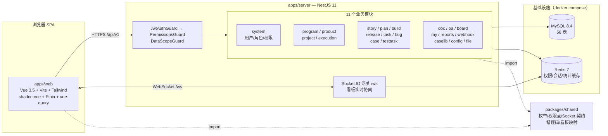
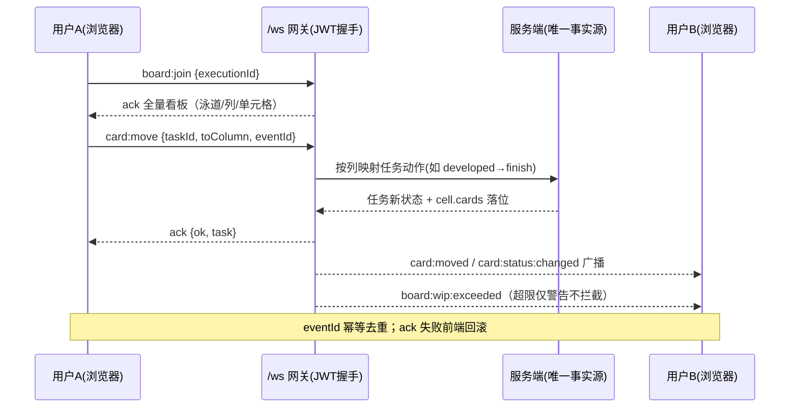
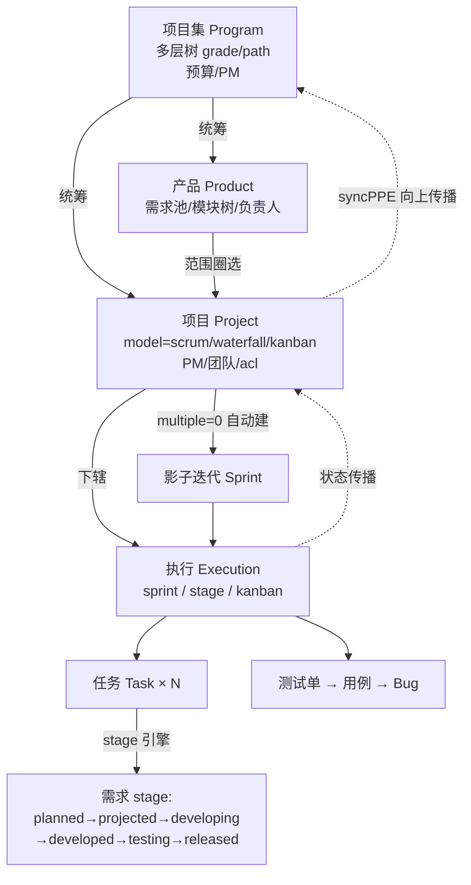
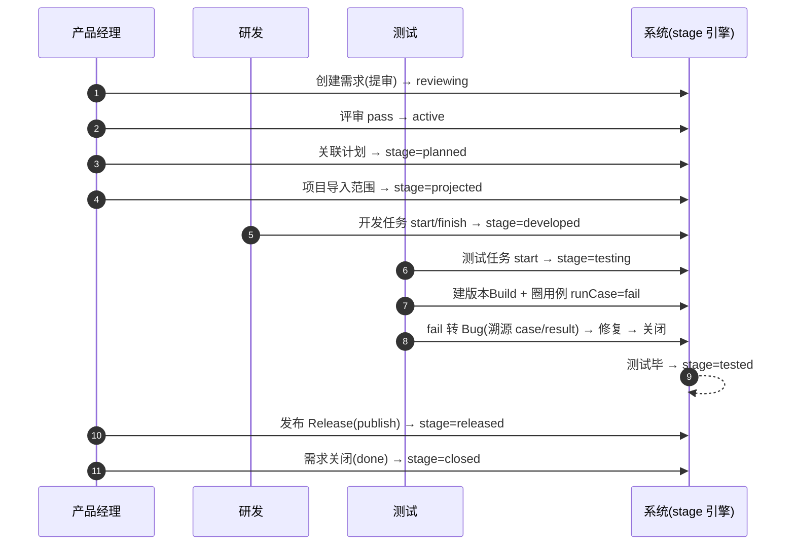

# zentao-nest

[](https://github.com/yhemeo613/zentao-nest/actions/workflows/ci.yml)


**禅道开源版（ZenTao 22.7）复刻** —— 依托 NestJS 模块化架构，完整还原禅道的 4 层管理框架与核心研发流程。前后端同仓 monorepo（pnpm workspaces + Turborepo），双端契约经 `packages/shared` 单源共享。

> **当前状态**：后端 8 阶段（P0-P7）全部验收通过并打标 [`backend-complete`](https://github.com/yhemeo613/zentao-nest/releases/tag/backend-complete)；前端完成骨架与登录链（F0/F1），F2-F3 页面交付中。
> 累计自动化验证：**130 项 HTTP 断言 + 62 项单元测试 + 权限漂移门禁 + Swagger 全量审计**，全部留档可复现。

---

## 目录

- [项目定位](#项目定位)
- [系统架构](#系统架构)
- [核心功能](#核心功能)
- [四层管理框架](#四层管理框架)
- [核心流程演示](#核心流程演示)
- [技术栈](#技术栈)
- [快速开始](#快速开始)
- [Docker 部署](#docker-部署)
- [验证与测试](#验证与测试)
- [仓库结构](#仓库结构)
- [开发约定与 AI 协作](#开发约定与-ai-协作)
- [路线图](#路线图)

---

## 项目定位

以禅道开源版 22.7 源码为**唯一业务事实源**（本地克隆于 `reference/zentaopms/`，逐模块校准），复刻其经过二十年验证的研发管理方法论：

| 复刻目标 | 落地情况 |
| --- | --- |
| **4 层管理框架** | 项目集 → 产品 → 项目 → 执行，逐层数据关联打通，支持多模型（Scrum/瀑布/看板） |
| **8 大核心概念全生命周期** | 需求、计划、发布、版本、任务、Bug、用例、测试单——每类实体的状态机均按禅道源码逐行校准（file:line 证据） |
| **核心研发流程闭环** | 需求→拆任务→完成→建版本→建测试单→执行用例→转 Bug→修复→关闭→发布，18 步一条龙 E2E 自动化验收通过 |
| **RBAC + 数据权限** | 功能权限 221 个权限点（DB 单源，与禅道 grouppriv 同构）+ 数据可见性三层模型（ACL 白名单/团队成员/干系人） |
| **审计与通知** | 全站操作日志（含字段级变更明细）+ 站内通知（指派/评审/解决自动触达收件人） |

**与禅道的关键差异**（有意取舍，均记录于 [ADR](docs/00-架构决策记录.md)）：富文本统一 Markdown；需求归属产品（禅道同）、项目经范围关联；看板卡片即业务对象本体（cell 存 ID 串）。

---

## 系统架构



**请求链**（全局注册，docs/01 §9）：

```
请求 → TraceId 中间件 → JwtAuthGuard（验签 + denylist）
     → PermissionsGuard（权限点 ← Redis 缓存 ← DB sys_permission）
     → DataScopeGuard（可见集 ← ACL 白名单 ∪ 团队成员）
     → Controller → Service（状态机 + 副作用）→ Repository
     → 统一响应 { code, message, data, traceId, timestamp }
```

**权限铁律**：JWT payload 仅含 `{sub, account, jti, typ}`——**不含角色/权限字段**；鉴权实时查 DB（Redis 缓存 10 分钟，授权变更主动失效），与禅道 grouppriv 模型同构，权限数据可直导。

---

## 核心功能

### 需求域（Story）

- **五态状态机**：draft → reviewing → active → changing → closed，含免评审开关（`sys_config.needReview`，启动即可配）与强制评审名单
- **多评审人裁决**：每版本独立评审记录（`zt_story_review`），allpass 规则全员评完自动裁决；**结果按版本裁剪**（v1 无 revert / v>1 无 reject）
- **变更版本化**：title/spec/verify 变化 → version+1 + 新版 spec + 评审人重置；受影响任务/用例仅展示提醒（storyVersion 落后标记），人工确认升级
- **15 值 stage 自动计算引擎**：任务（design/devel/test 三桶）、计划（planned）、执行关联（projected）、发布（released）、关闭（closed）——八段全程自动推进
- 需求拆分（estimate=Σ子、父子联动）、Bug 转需求（closed/tostory 回写）、撤回变更/撤回评审

### 任务域（Task）

- **六态状态机**：start(仅 wait)/restart(仅 pause)/pause(仅 doing)/finish/cancel/close(仅 done·cancel)/activate(返工，必填剩余工时)——非法流转统一 3006
- **工时是状态的驱动源**：记工时 left=0 → done、wait → doing、终态且 left≠0 → doing（隐式迁移）；consumed=Σeffort 只增不减、left=最后一条流水
- 父子任务聚合（工时 Σ、状态推导优先级）与向下传播（父暂停同步暂停子任务）
- 看板拖拽 = 按列映射动作（服务端唯一事实源）

### 质量域（Bug / Case / TestTask / Build / Release）

- **Bug**：confirm 仅标记、resolve（fixed 必填解决构建/回指派开单人）、activate 重开计数、**转需求独立动作**
- **用例**：默认免评审、步骤版本化（version+1 整套重插）、storyChanged 人工确认
- **测试单**：四态（done=已关闭）、圈用例（replace+版本快照）、**runCase 三写**（case.lastRun* + test_result 明细 + test_run）、**fail 转 Bug 全程溯源**（case/result/testtask）、首次执行自动 doing
- **Build**：关联 Bug 自动置 resolved/fixed/resolvedBuild；**Release**：发布触发需求 stage=released、遗留 Bug 标记、terminate 语义

### 实时看板（Socket.IO）



自定义泳道/列（父子结构 + WIP 限制）、在线成员 presence、断线自动重连重放 join。

### 横切能力

| 能力 | 说明 |
| --- | --- |
| **RBAC** | 221 个权限点（`(module, action)` 与禅道 grouppriv 同构）、7 预置角色、项目级角色覆盖、超管直通、`limited` 受限组 |
| **数据权限** | 对象 `acl`（open/private）+ `sys_acl` 白名单 + 团队成员 + 可见集预计算（Redis 物化），列表统一 `IN(可见集)` 过滤、单对象 2004 |
| **审计** | 全站动作落 `zt_action_log` + 字段级 `zt_action_history`（动态流/明细接口） |
| **通知** | 站内信（未读计数/标记已读）：指派、提审→评审人、解决→开单人自动触达；动作矩阵可订阅（webhook 表已备） |
| **文档** | 空间→库→文档，Markdown 正文版本化（编辑 version+1，历史可追溯） |
| **事务** | 待办四态 + 通用工时填报（objectType 通用，未来日期 4703） |
| **统计** | 项目概览/执行负载/产品质量（通过率/缺陷密度）/路线图聚合接口 |

---

## 四层管理框架



- 执行类型由项目模型自动映射（`scrum→sprint / waterfall→stage / kanban→kanban`）；`multiple=0` 项目自动创建**影子迭代**
- **syncPPE 向上传播**：执行 doing → 项目 wait→doing → 项目集 wait→doing（任务驱动链随前端交付补充）
- 执行关闭级联：子阶段须全部 closed；回 wait 校验（有 realBegan 或工时消耗拒绝 4602）
- 项目范围两级关联（`zt_project_story` scope_type=project/execution）：按计划导入自动写两级 + unlink 执行占用保护

---

## 核心流程演示

一条需求的完整生命周期（`e2e-fullchain.mjs` 自动化验收的 18 步）：



E2E 断言逐点校验上述每个 stage 跃迁与全部状态字段，脚本见 [验证与测试](#验证与测试)。

---

## 技术栈

| 层 | 选型 |
| --- | --- |
| 后端 | NestJS 11 · TypeScript 6（ESM/strict）· TypeORM 1.x（migration 管线，生产禁 synchronize）· MySQL 8.4 · Redis 7 · Passport JWT · Socket.IO · Swagger |
| 前端 | Vue 3.5 · Vite 6 · Tailwind CSS 4 · Pinia · @tanstack/vue-query · socket.io-client · axios（统一解包/401 刷新） |
| 工程化 | pnpm workspaces · Turborepo · Husky + commitlint + lint-staged · Vitest · GitHub Actions CI |
| 部署 | Docker multi-stage 双镜像 · docker-compose 四容器（迁移先行门禁） |

---

## 快速开始

> 前置：Node ≥ 22、pnpm 10、Docker

```bash
# 1. 安装依赖
pnpm install

# 2. 准备环境变量
cp .env.example .env           # 根：MySQL/Redis 凭据 + JWT_SECRET
cp apps/server/.env.example apps/server/.env

# 3. 启动基础设施（MySQL + Redis）
docker compose up -d mysql redis

# 4. 数据库迁移（首轮建 58 表）
cd apps/server
pnpm exec tsx node_modules/typeorm/cli.js migration:run -d src/database/data-source.ts
cd ../..

# 5. 并行启动后端 + 前端
pnpm dev                       # server :3000 / web :5173
```

启动后：

| 入口 | 地址 | 说明 |
| --- | --- | --- |
| 前端 | http://localhost:5173 | 登录后进「我的概览」 |
| Swagger | http://localhost:3000/api/docs | 229 端点全注解（右上角 Authorize 填 accessToken） |
| 健康检查 | http://localhost:3000/api/v1/health | DB/Redis 连通性 |

**种子账号**：`admin / Admin@123456`（超管，密码来自 `SEED_ADMIN_PASSWORD`）；启动日志可见 `[seed] 权限点就绪（221 个）` 与 7 个预置角色。正式部署务必修改 `JWT_SECRET` 与管理员密码。

---

## Docker 部署

```bash
cp .env.example .env           # 修改 JWT_SECRET / SEED_ADMIN_PASSWORD
docker compose up -d --build   # 四容器：mysql → redis → server → web
```

| 容器 | 端口 | 说明 |
| --- | --- | --- |
| zentao-mysql | 3306 | utf8mb4，volume 持久化，healthcheck 门禁 |
| zentao-redis | 6379 | AOF 持久化 |
| zentao-server | 3000 | 迁移先于应用（生产 `synchronize=false`） |
| zentao-web | 80 | nginx：SPA 回退 + `/api` 反代 + `/ws` WebSocket upgrade |

访问 `http://localhost`（web 容器 nginx）即完整可用系统。

---

## 验证与测试

```bash
# 单元测试（62 项：状态机表驱动/枚举契约/权限点/错误码）
pnpm --filter @zentao/server exec vitest run test/unit

# HTTP 断言回归（需服务运行中；退出码 = 失败数）
node apps/server/test/http/p2-assert.mjs           # 四层框架 26 例
node apps/server/test/http/p3-assert.mjs           # 核心实体流转 31 例
node apps/server/test/http/e2e-fullchain.mjs       # 全链路闭环 18 例
node apps/server/test/http/p5-assert.mjs           # doc/oa/审计/通知 26 例
node apps/server/test/http/p6-assert.mjs           # 看板/配置/统计/附件等 29 例

# 契约与审计
node apps/server/test/http/swagger-full-audit.mjs  # Swagger 229 端点结构 4 项
node apps/server/scripts/permission-drift-check.mjs # 权限点漂移门禁（shared ↔ DB）
```

CI（GitHub Actions）每次 push 自动执行：类型门禁 → 单测 → 构建 → **集成回归**（service 容器起 MySQL/Redis → 迁移先行 → 启动 → 漂移门禁 → 六脚本全量回归）。

> 验收明细（每阶段测试矩阵/缺陷记录）见 [docs/07-阶段测试与验收规范.md](docs/07-阶段测试与验收规范.md)；进度仪表盘见 [docs/08](docs/08-开发进度与交付状态.md)。

---

## 仓库结构

```text
zentao-nest/
├── apps/
│   ├── server/                  # NestJS 后端
│   │   ├── src/
│   │   │   ├── common/          # 守卫/拦截器/过滤器/Redis/Swagger 助手
│   │   │   ├── modules/         # 15 个业务模块（每域 controller/service/entities/dto）
│   │   │   └── database/        # data-source + 迁移（58 表）
│   │   ├── test/
│   │   │   ├── unit/            # Vitest 单测（62 项）
│   │   │   └── http/            # HTTP 断言脚本（130 项，可复现）
│   │   └── Dockerfile
│   └── web/                     # Vue3 前端
│       ├── src/                 # api/ lib/ stores/ router/ views/ layouts/
│       └── Dockerfile           # nginx 托管 + 反代
├── packages/
│   └── shared/                  # ★ 双端同源契约包（零运行时依赖）
│       ├── enums/               # 需求/任务/质量枚举 + 流转表 + 隐式迁移纯函数
│       ├── permissions.ts       # 221 权限点常量（种子/守卫/v-permission 单源）
│       ├── socket-contract.ts   # Socket 事件与 payload/ack 类型
│       ├── kanban-map.ts        # 状态↔看板列映射
│       ├── error-codes.ts       # 错误码注册表 + HTTP 段位推导
│       └── dto/http.ts          # 统一响应体/分页类型
├── docs/                        # 设计文档体系（8 份，README 为导航）
├── reference/zentaopms/         # 禅道源码参照（本地，gitignore）
├── docker-compose.yml           # 四容器编排
└── .github/workflows/ci.yml     # CI 流水线
```

**文档体系**（互引闭环，冲突仲裁权见 [docs/README](docs/README.md)）：

| 文档 | 内容 |
| --- | --- |
| [00-架构决策记录](docs/00-架构决策记录.md) | 13 项关键决策（ADR 只增不改） |
| [01-总体设计](docs/01-总体设计.md) | 后端架构/模块/开发计划 |
| [02-业务流程规格](docs/02-业务流程规格.md) | 禅道源码校准的状态机与流转（**业务最高仲裁**） |
| [03-接口与契约](docs/03-接口与契约.md) | 端点/权限点/错误码/DTO/Socket 契约 |
| [04-数据与种子](docs/04-数据与种子.md) | 58 表字段级字典/种子数据/性能基准 |
| [05-前端架构](docs/05-前端架构.md) | 前端选型/基础设施/页面架构 |
| [06-代码规范](docs/06-代码规范.md) | 编码/提交/AI 协作纪律（husky 门禁） |
| [07-阶段测试与验收](docs/07-阶段测试与验收规范.md) | 各阶段测试矩阵与缺陷记录 |
| [08-开发进度与交付状态](docs/08-开发进度与交付状态.md) | 进度仪表盘（随里程碑同步） |
| [09-差距分析与演进路线](docs/09-差距分析与演进路线.md) | 对标禅道 102 模块的缺口全景与三阶段路线 |

---

## 开发约定与 AI 协作

- **AGENTS.md**：AI 编码代理边界守则——技术栈/目录/契约/业务逻辑五重边界 + 提交前自检清单 + 「交付验证边界」（端到端验证是完成的前置条件、同会话自产契约必须 grep 对照、交付报告必须含已验证/未验证清单）
- **文档先行**：实现必须能指到 docs/ 规格章节；业务规则疑义以 docs/02（禅道源码证据）为最高仲裁
- **提交规范**：`type: 中文描述`，husky 强制 prettier + commitlint，禁止绕过钩子

---

## 路线图

- [x] **P0-P7 后端全量**（tag [`backend-complete`](https://github.com/yhemeo613/zentao-nest/releases/tag/backend-complete)）
- [x] F0/F1 前端骨架与登录链
- [ ] F2-F3 前端集中交付（四层框架页面 + 8 大实体页面，含看板 Socket）
- [ ] P7 遗留：性能 P95 实测 / Prometheus 监控 / 镜像 registry 构建
- [ ] 登记简化项随前端需要补齐（多人任务 linear/multi、Excel 导入导出、通知多收件人等）

## License

MIT（代码）；禅道业务方法论版权归青岛易软天创（本项目仅为学习性复刻，参照其开源版 GPL 源码的公开逻辑）。
