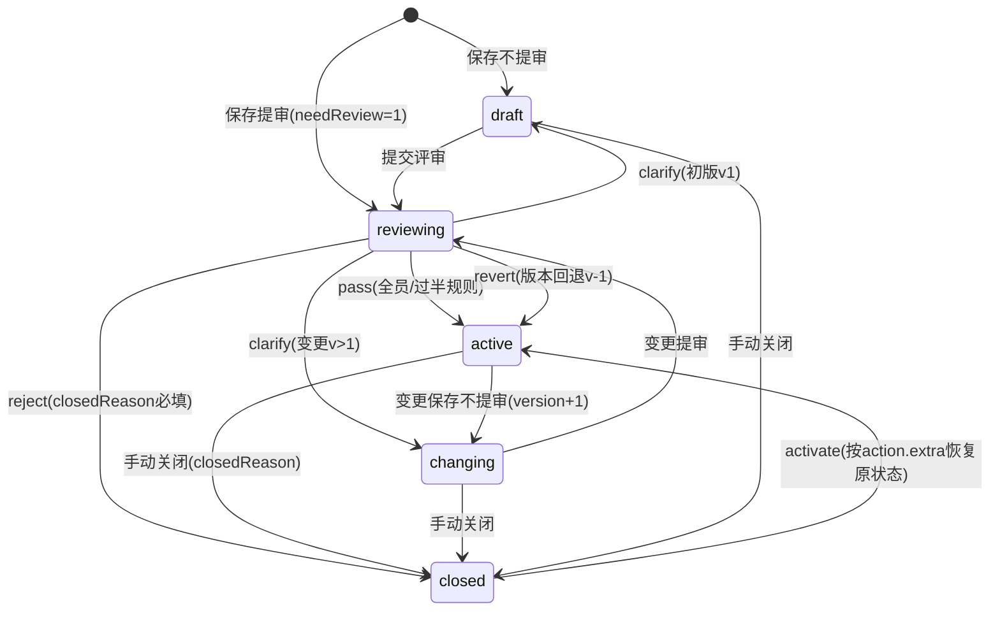
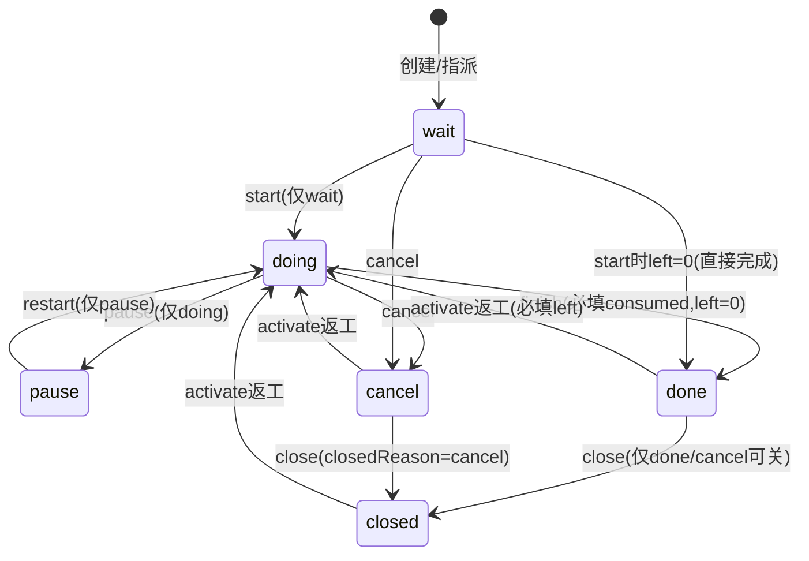
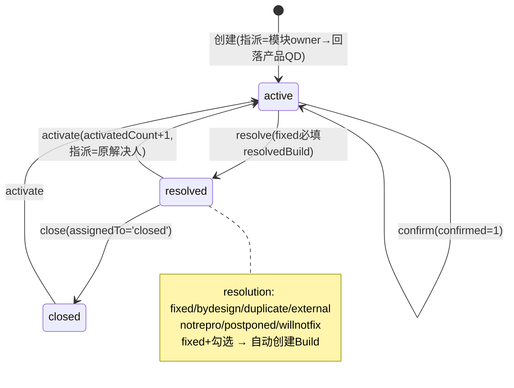
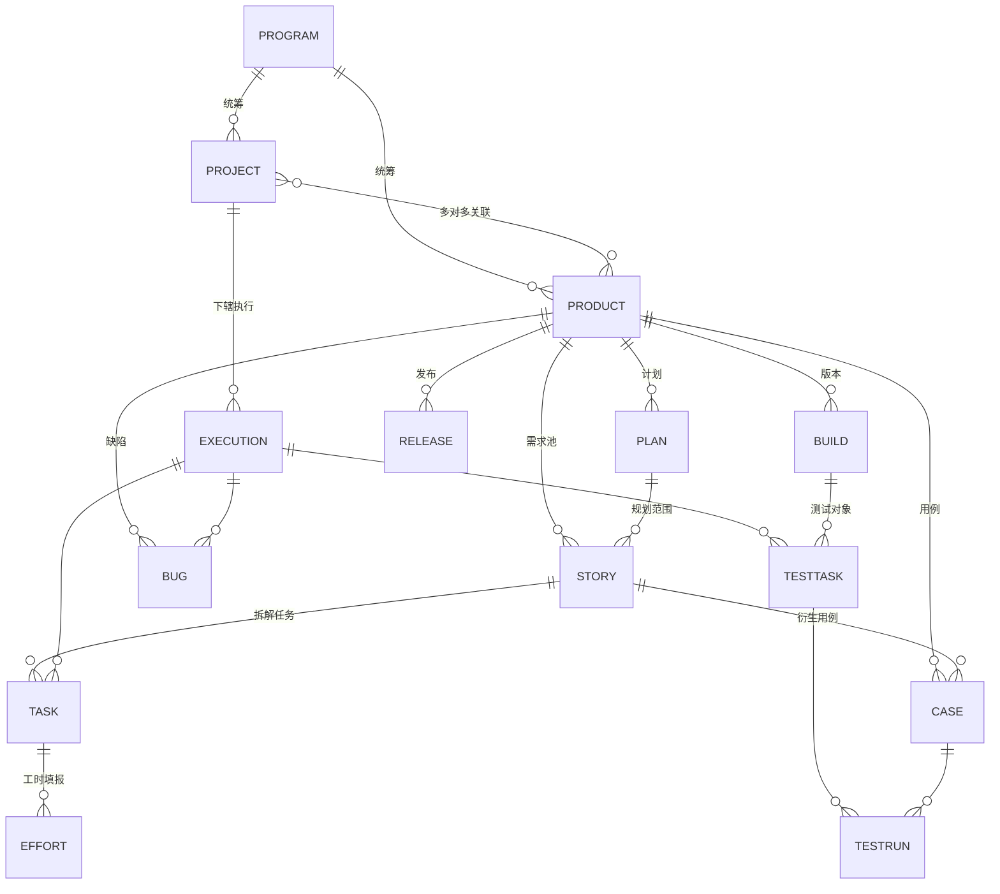

# 禅道项目管理系统复刻（NestJS 版）— 总体设计文档

| 项 | 内容 |
| --- | --- |
| 文档版本 | v0.3（工程结构升级为 monorepo，与文档体系 v2.0 重构同步） |
| 日期 | 2026-11-05 |
| 项目代号 | zentao-nest |
| 参照基准 | 禅道开源版 22.7（github.com/easysoft/zentaopms，本地克隆于仓库根 `reference/zentaopms/`） |
| 配套文档 | [00-架构决策记录](./00-架构决策记录.md) ｜ [02-业务流程规格](./02-业务流程规格.md)——业务流程与状态机的权威规格；[03-接口与契约](./03-接口与契约.md)——接口/权限点/错误码/DTO/Socket 契约/shared 同源包；[04-数据与种子](./04-数据与种子.md)——字段级实体规格、种子数据、单测目标、性能基准；[05-前端架构](./05-前端架构.md)——前端选型/基础设施/页面架构。导航见 [README](./README.md)；流程冲突以 02 为准 |

---

## 1. 项目概述

### 1.1 复刻定位

依托 NestJS 模块化架构（依赖注入、低耦合模块），完整还原禅道的 **4 层管理框架** 与 **核心研发流程**：

1. **优先对齐禅道开源版核心能力**：覆盖项目集（Program）、产品（Product）、项目（Project）、执行（Execution）4 层管理结构；
2. **完整实现 8 个核心概念的全生命周期流转**：需求（Story）、计划（Plan）、发布（Release）、版本（Build）、任务（Task）、Bug、用例（Case）、测试单（TestTask）；
3. **兼容主流项目管理模型**：以 Scrum、瀑布、看板为一等公民，目标覆盖 9 种主流模型，通过项目级 `model` 配置切换。

### 1.2 核心研发流程闭环（必须跑通）

```
项目集 → 创建产品 → 收集需求 → 计划(Plan) → 关联项目
      → 执行(迭代/阶段) → 需求拆任务 → 开发提测(测试单/版本)
      → Bug 反馈 → 修复回归 → 版本发布(Release) → 需求关闭
```

---

## 2. 技术栈选型

| 分类 | 选型 | 说明 |
| --- | --- | --- |
| 后端框架 | NestJS 10+ + TypeScript | 依赖注入实现低耦合模块化开发 |
| ORM | TypeORM | 实体定义对齐禅道原生表结构核心字段与关联 |
| 数据库 | MySQL 8.x | 主存储，utf8mb4，InnoDB |
| 缓存 | Redis 7.x | 缓存权限、会话（token 黑名单）、高频统计数据（燃尽图快照、看板聚合） |
| 认证 | JWT（access + refresh 双 token） | payload 仅含身份标识，**不含角色/权限字段**（见 §9） |
| 接口文档 | Swagger（@nestjs/swagger） | 装饰器自动生成，随代码演进 |
| 实时通信 | Socket.IO（@nestjs/websockets + Redis adapter） | 看板多人实时同步，多实例水平扩展 |
| 看板模块 | `@flusys/nestjs-task-manager`（已确认存在于 npm，Flusys 生态） | 动态看板 + Socket.IO 协同；集成摩擦大时兜底方案为原生网关自实现 |
| 参数校验 | class-validator + class-transformer | DTO 全量校验 |
| 测试 | Jest（单元）+ Supertest（E2E） | |
| 部署 | Docker + docker-compose（multi-stage build，compose 位于 monorepo 根） | mysql / redis / server / web 四容器 |

---

## 3. 总体架构

### 3.1 架构分层

```
┌───────────────────────────────────────────────────────────┐
│        Client（Web 前端 / Swagger UI / Socket.IO 客户端）    │
└──────────────────────────┬────────────────────────────────┘
                           │ HTTPS / WebSocket
┌──────────────────────────▼────────────────────────────────┐
│ main.ts：全局注册 ValidationPipe / 拦截器 / 异常过滤器       │
│  请求链：JwtAuthGuard → PermissionsGuard → DataScopeGuard  │
│         → LoggingInterceptor → ResponseFormatInterceptor   │
├───────────────────────────────────────────────────────────┤
│ modules/ 业务模块层                                         │
│   system │ program │ product │ project │ execution         │
│   quality │ doc │ oa │ board(实时看板)                      │
├───────────────────────────────────────────────────────────┤
│ common/ 公共组件层                                          │
│   guards │ interceptors │ filters │ pipes │ decorators     │
├───────────────────────────────────────────────────────────┤
│ database/ TypeORM 连接、迁移脚本、种子数据                    │
├──────────────────────────┬────────────────────────────────┤
│   MySQL 8.x              │   Redis（权限/会话/统计缓存）      │
└──────────────────────────┴────────────────────────────────┘
```

### 3.2 工程结构（Monorepo）

> 决策依据见 [00-架构决策记录 D001](./00-架构决策记录.md)：pnpm workspaces + Turborepo，前后端同仓并行开发，契约常量经 `packages/shared` 单源共享。

```text
zentao-nest/                         # monorepo 根
├── pnpm-workspace.yaml              # workspaces: apps/*, packages/*
├── turbo.json                       # dev / build / test / lint 任务编排
├── package.json                     # 根脚本：pnpm dev = server+web 并行
├── docker-compose.yml               # 四容器：mysql / redis / server / web（§13）
├── docs/                            # 本文档体系（README 为导航）
├── reference/zentaopms/             # 禅道源码参照（只读，不参与构建）
├── apps/
│   ├── server/                      # NestJS 后端（目录结构见下）
│   └── web/                         # Vue3 前端（目录结构见 05-前端架构 §3）
└── packages/
    └── shared/                      # 双端同源契约包（内容清单见 03-接口与契约 §13）
```

**apps/server 目录结构**（各模块 detail 见 §6）：

```text
apps/server/src/
├── app.module.ts          # 根模块，统一导入所有业务模块
├── main.ts                # 应用启动入口，全局注册校验、拦截器
├── common/                # 公共组件
│   ├── guards/            # JwtAuthGuard / PermissionsGuard / DataScopeGuard
│   ├── interceptors/      # 统一响应格式、日志切面（traceId）
│   ├── filters/           # 全局异常过滤器（统一错误码）
│   ├── pipes/             # DTO 参数自动校验
│   └── decorators/        # @Permissions() @CurrentUser() @DataScope() 等
├── modules/
│   ├── system/            # 组织管理模块（用户、角色、权限、部门）
│   ├── program/           # 项目集管理模块（多层级、资源统筹）
│   ├── product/           # 产品管理模块（需求池、计划、发布）
│   ├── project/           # 项目管理模块（多管理模型配置）
│   ├── execution/         # 执行管理模块（迭代/阶段、任务、燃尽图）
│   ├── quality/           # 质量管理模块（用例、Bug、测试单、版本）
│   ├── board/             # 实时看板（Socket.IO 同步）
│   ├── doc/               # 文档管理模块
│   └── oa/                # 事务管理模块（待办、工时日志、通知、操作日志）
└── database/              # 数据库配置、迁移脚本、种子数据（seed/roles.matrix.ts）
```

**并行开发工作流**：根目录 `pnpm install` 一次装齐；`pnpm dev` 经 turbo 并行启动 `nest start --watch`（:3000）与 `vite`（:5173，proxy `/api`、`/ws` → server）。`packages/shared` 变更由 turbo 依赖图自动触发双端重编译，契约漂移在编译期暴露。

---

## 4. 核心领域模型

### 4.1 四层管理框架

| 层 | 概念 | 职责 | 关键关系 |
| --- | --- | --- | --- |
| L1 | 项目集 Program | 统筹多项目、多产品、资源与预算；支持多层级子项目集 | `parent_id` 自关联形成树；下辖多个 Product 与 Project |
| L2 | 产品 Product | 需求池、需求拆分、路线图、计划与发布 | 属于某项目集（可独立）；下辖 Story/Plan/Release/Build/Case/Bug |
| L3 | 项目 Project | 研发执行主体；绑定管理模型（Scrum/瀑布/看板等）、团队与权限 | 属于项目集；与 Product 多对多关联；下辖多个 Execution |
| L4 | 执行 Execution | Scrum 下=迭代(Sprint)、瀑布下=阶段(Stage)、看板下=看板；拆任务、追进度、燃尽图 | 属于项目；下辖 Task/Bug/TestTask |

> **与禅道原生实现的差异说明**：禅道开源版将「项目/执行」共用于 `zt_project` 一张表（通过 `project` 字段与 `grade` 区分层级）。本复刻版拆分为独立 `zt_project` / `zt_execution` 两表，外键关系显式化，关联语义保持一致。

### 4.2 八大核心实体

| # | 实体 | 表名 | 归属模块 | 生命周期要点（v0.2 源码校准） |
| --- | --- | --- | --- | --- |
| 1 | 需求 Story | zt_story | product | 草稿→**评审中**→激活→变更→关闭；关闭原因：done/subdivided/duplicate/postponed/willnotdo/cancel/bydesign；另有 **15 值 stage 阶段自动计算引擎** |
| 2 | 计划 Plan | zt_productplan | product | 状态 wait/doing/done/closed；需求关联后驱动 stage=planned |
| 3 | 发布 Release | zt_release | product | 状态 **wait/normal/fail/terminate**；转 normal 时批量置需求 stage=released |
| 4 | 版本 Build | zt_build | quality | 执行产物；关联 Bug 时自动将未解决 Bug 置 fixed+resolvedBuild |
| 5 | 任务 Task | zt_task | execution | wait/doing/pause/done/cancel/closed；**close 仅从 done/cancel**；activate=返工；支持多人任务(taskteam)、子任务、工时隐式驱动状态 |
| 6 | 缺陷 Bug | zt_bug | quality | active→resolved→closed；confirm 仅标记；activate 返还给原解决人并计数；转需求为独立动作 |
| 7 | 用例 Case | zt_case | quality | **默认免评审**（wait/normal/blocked/investigate）；版本化步骤；storyChanged 人工确认机制 |
| 8 | 测试单 TestTask | zt_testtask | quality | wait/doing/**done(=已关闭)**/blocked；执行用例自动推进 doing；无自动完成 |

### 4.3 项目管理模型（源码校准）

- **源码事实**（`module/project/lang/zh-cn.php:345-351`）：禅道 model 枚举为 `''/scrum/waterfall/kanban/agileplus/waterfallplus/ipd`，**开源版实际可用 scrum/waterfall/kanban 三种**（其余为 Max/IPD 专版特性）；宣传的「9 种研发管理框架」无对应源码枚举。
- **复刻策略**：一期一等公民落地 `scrum/waterfall/kanban`；`model` 字段开放枚举 + `model_config` JSON 扩展，9 种清单待产品侧确认（§14）。
- 模型差异映射执行层（`module/execution/config.php:15-18`）：`scrum→sprint`、`waterfall→stage`、`kanban→kanban`；multiple=0 的项目自动建影子迭代（`createDefaultSprint`）。

### 4.4 核心状态机（v0.2 按源码重绘，操作级细则见《流程细化》§4.2/§6.1/§7）

**需求 Story**（含评审流；免评审配置 needReview=0 时不产生 reviewing）



**任务 Task**（操作→状态权威表见流程细化 §6.1；工时可隐式驱动状态迁移）



**缺陷 Bug**（confirm 仅标记不改状态；转需求 tostory 为独立动作不走 resolve）



---

## 5. 数据库设计

### 5.1 设计原则

1. 参考**禅道原生表结构**，保留核心字段与关联关系，但做 TypeORM 风格规范化：
   - 主键统一 `id BIGINT AUTO_INCREMENT`；
   - 字段名 snake_case（禅道为驼峰）；
   - 外键关系显式化（逻辑外键 + 索引，不强制物理外键约束，便于数据迁移）；
   - 统一审计字段：`created_by / created_at / updated_at / deleted_at`（软删除）。
2. 高频查询字段建索引：各层级外键（`product_id`、`project_id`、`execution_id`、`story_id`）、状态、优先级、`assigned_to`。
3. 需求/用例的描述采用**版本化历史表**（`zt_story_spec`、`zt_case_step` 按 version 存储），保证任务/测试单引用的历史版本可追溯。

### 5.2 系统权限域（system 模块）

| 表 | 说明 | 关键字段 |
| --- | --- | --- |
| sys_user | 用户 | account(UQ), password(bcrypt), realname, role(岗位), dept_id, email, mobile, status, last_login_at |
| sys_dept | 部门 | parent_id, path(物化路径), name |
| sys_role | 角色 | name, code(UQ), remark, is_super(超管标记) |
| sys_user_role | 用户-角色 | user_id, role_id |
| sys_permission | 权限点 | module, action, path, http_method, name, sort —— **接口权限源，对齐禅道 grouppriv 的 module/method 结构** |
| sys_role_permission | 角色-权限 | role_id, permission_id |
| sys_acl | 数据权限 | scope_type(program/product/project/execution), scope_id, acl(open/private/custom), whitelist_user_ids(JSON) —— 对齐禅道 acl + whitelist 机制 |

> **Redis 权限缓存**：`rbac:user:{userId}:permissions`，TTL 10 分钟；角色/授权变更时主动失效。接口鉴权实时读缓存（未命中回源数据库），**绝不读 JWT 内的角色字段**。

### 5.3 四层框架域

**zt_program（项目集）**

| 字段 | 类型 | 说明 |
| --- | --- | --- |
| parent_id | bigint | 父项目集，支持多层级 |
| grade | tinyint | 层级深度 |
| path | varchar | 物化路径，如 `/1/5/8/` |
| order_no | int | 同级排序 |
| name / code | | 名称/编码 |
| pm_id | bigint | 项目集经理 |
| budget | decimal | 预算 |
| begin / end | date | 起止 |
| status | varchar | active/suspended/closed |

**zt_product（产品）**

| 字段 | 类型 | 说明 |
| --- | --- | --- |
| program_id | bigint | 所属项目集（可空=独立产品） |
| line_id | bigint | 产品线 |
| name / code | | |
| po_id / qd_id | bigint | 产品负责人 / 测试负责人 |
| status | varchar | active/closed |

**zt_project（项目）**

| 字段 | 类型 | 说明 |
| --- | --- | --- |
| program_id | bigint | 所属项目集 |
| name / code | | |
| model | varchar | scrum/waterfall/kanban/…（开放枚举，目标 9 种） |
| begin / end / days | | 起止与工作日数 |
| pm_id | bigint | 项目经理 |
| status | varchar | wait/doing/suspended/closed |
| model_config | json | 模型差异配置（阶段模板/看板列/WIP 等） |

**zt_project_product**：项目-产品多对多关联表。

**zt_execution（执行）**

| 字段 | 类型 | 说明 |
| --- | --- | --- |
| project_id | bigint | 所属项目 |
| type | varchar | sprint/stage/kanban |
| stage_type | varchar | 瀑布阶段类型（需求/设计/开发/测试/发布），仅 stage 时 |
| name | | 如「迭代 12」 |
| begin / end / days | | |
| status | varchar | wait/doing/suspended/closed |
| sprint_goal | varchar | 冲刺目标（Scrum） |

**zt_execution_burn（燃尽图快照）**：execution_id, date, estimate_total, consumed_total, left_total —— 每日定时任务生成，Redis 缓存高频读取。

### 5.4 核心业务域（product / execution 模块）

**zt_story（需求）**

| 字段 | 类型 | 说明 |
| --- | --- | --- |
| product_id / branch_id / module_id / plan_id | bigint | 归属 |
| title | varchar | |
| type | varchar | story/requirement(用户需求)/target |
| pri | tinyint | 1-4 |
| estimate | decimal | 预估工时（小时） |
| stage | varchar | 需求阶段（禅道概念） |
| status | varchar | draft/reviewing/active/changing/closed |
| stage | varchar | 需求阶段 15 值（wait/planned/projected/designing/designed/developing/developed/testing/tested/verified/rejected/delivering/delivered/released/closed），由 setStage 引擎自动计算（任务/计划/发布/人工触发） |
| closed_reason | varchar | done/subdivided/duplicate/postponed/willnotdo/cancel/bydesign |
| source / source_note | | 来源 |
| spec / verify | text | 需求描述 / 验收标准（版本化到 zt_story_spec） |
| opened_by/assigned_to/closed_by | bigint | 人员流转 |
| parent_id | bigint | 需求拆分父子关系 |

**zt_story_spec**：story_id, version, title, spec, verify —— 每次变更产生新版本。

**zt_productplan（计划）**：product_id, title, begin, end, desc；通过 `zt_plan_story` 关联需求。

**zt_task（任务）**

| 字段 | 类型 | 说明 |
| --- | --- | --- |
| project_id / execution_id | bigint | 归属（必填 execution） |
| story_id / story_version | bigint/int | 关联需求及其版本快照 |
| parent_id | bigint | 子任务 |
| name / desc | | |
| type | varchar | devel/test/design/unti/... |
| pri | tinyint | |
| estimate / consumed / left | decimal | 预估 / 已消耗 / 剩余工时 |
| status | varchar | wait/doing/pause/done/cancel/closed |
| assigned_to / finished_by / closed_by | bigint | |
| pre_task_id | bigint | 前置任务（依赖） |

**zt_effort（工时流水，v22 源码校准）**：object_type(task/story/bug/case/todo 通用), object_id, product, project, execution, account, date, consumed, left, work, begin/end —— 聚合规则：`task.consumed = Σeffort.consumed`（软删除外）、`task.left = 最后一条 effort 的 left`、consumed 只增不减；**记工时隐式驱动任务状态**（left=0→done、wait→doing、done/pause/cancel/closed 且 left≠0→doing）。原 zt_task_estimate 表在 v22 已废弃，不建。

### 5.5 质量域（quality 模块）

**zt_bug（缺陷）**

| 字段 | 类型 | 说明 |
| --- | --- | --- |
| product_id / project_id / execution_id / module_id | bigint | 归属 |
| title / steps | | 标题 / 重现步骤 |
| severity | tinyint | 1-4 |
| pri | tinyint | |
| type | varchar | code/config/interface/... |
| status | varchar | active/resolved/closed |
| resolution | varchar | fixed/bydesign/duplicate/external/postponed/notrepro/willnotfix（tostory 为独立「转需求」动作，不走 resolve） |
| story_id / case_id / build_id / resolved_build_id | bigint | 关联：所属需求/关联用例/发现于版本/解决于版本 |
| opened_by / assigned_to / resolved_by / closed_by | bigint | |
| confirmed / activated_count | | 确认标记 / 重开次数 |

**zt_case（用例）+ zt_case_step（步骤）**

- zt_case：product_id, module_id, story_id, title, pri, type(manual/auto), stage, status, last_run_result, last_runner, last_run_date
- zt_case_step：case_id, version, step_no, step_type(step/group), desc, expect —— 用例**版本化步骤**（步骤+预期）。

**zt_testtask（测试单）+ zt_testrun（执行记录）**

- zt_testtask：product_id, project_id, execution_id, build_id, name, begin, end, owner_id, desc, status(wait/doing/**done=已关闭**/blocked)；start 仅 wait 可用、block 从 wait/doing、activate 从 blocked/done、close 从非 done（源码 isClickable 校准）
- zt_testrun：task_id, case_id, case_version, last_run_result(pass/fail/blocked), last_runner_id, last_run_date, pre_case_id（用例排序）

**zt_build（版本）**：product_id, project_id, execution_id, name, scm_path, date, desc；`zt_build_story`（范围需求）、`zt_build_bug`（修复 Bug）关联。

**zt_release（发布）**：product_id, build_id, name, date, desc, status；范围需求与遗留 Bug 通过关联表维护。

### 5.6 辅助域

| 表 | 模块 | 说明 |
| --- | --- | --- |
| zt_doc_lib / zt_doc / zt_doc_content | doc | 文档库（产品/项目/执行/个人）→ 文档 → 版本化正文 |
| zt_todo | oa | 待办：type(task/bug/...) + 关联对象 + 日期 + 状态 |
| zt_effort | oa | 工时日志（可脱离任务独立填报） |
| zt_message | oa | 站内信/通知（指派、评论、@提及、状态变更触发） |
| zt_action | oa | **全站操作日志**：objectType, object_id, actor, action, comment —— 由通用切面写入 |
| zt_file | doc/common | 附件（本地/OSS 存储） |
| board_lane / board_column / board_cell | board | 对齐禅道三表：泳道(type=story/bug/task) / 列(含 **parent 父子列结构 + limit=WIP**) / 单元格(cards 存对象 ID 串)——卡片即任务/Story/Bug 本体，不建独立卡片表（源码校准，见流程细化 §8.1） |

### 5.7 核心实体关系



---

## 6. 模块详细设计

### 6.1 system —— 系统权限模块（权限底座，最先开发）

- **RBAC 细粒度权限控制**，参考 `nest-admin` 成熟实现：
  - `sys_permission` 表预置全量接口权限点（module + action → 对应控制器路由）；
  - `PermissionsGuard` 依据「路由 module/action」查数据库（Redis 缓存优先）判断当前用户角色是否含该权限点，**不依赖 JWT 内角色字段**；
  - 超管角色（is_super）直通。
- 用户、角色、权限点、部门的完整 CRUD 与关联管理；
- 登录（bcrypt 校验）→ 签发 access_token（短效）+ refresh_token（长效，Redis 白名单可吊销）；
- **数据权限隔离**：`DataScopeGuard` 按「项目集/产品/项目/执行」维度校验成员可见性（open / private / custom 白名单），在 Service 层通过统一的数据范围仓库方法落地查询过滤。

### 6.2 program —— 项目集模块

- 多层级子项目集创建（`parent_id` + `path` 物化路径 + `grade`），树形查询、拖拽排序；
- 项目集下产品/项目/团队的统筹视图（资源概览）；
- 预算与起止管理；数据权限（acl）配置。

### 6.3 product —— 产品管理模块

- 产品 CRUD、产品线、模块树（`zt_module`，需求/用例共用模块树）；
- **需求池**：需求全生命周期（draft→reviewing→active→changing→closed，含免评审开关与强制评审名单）、多评审人评审（allpass/halfpass 裁决）、需求变更（spec 版本+1，受影响任务/用例**仅展示提醒不自动改写**，人工确认升级版本）、需求拆分（父子联动）；
- **计划 Plan**：时间窗规划需求集合；
- **发布计划/Release**：基于 Build 发布，统计范围需求完成度与遗留 Bug；
- 路线图视图（按计划聚合）。

### 6.4 project —— 项目管理模块

- 项目 CRUD，绑定项目集、关联多个产品；
- **多管理模型切换配置**：model 字段 + model_config（不同模型下执行层的默认形态、阶段模板、看板列模板）；
- 项目团队管理（成员+角色：PM/开发/QA，对齐禅道 team 概念）、项目级 acl；
- 项目概览统计（需求/任务/Bug 聚合，Redis 缓存）。

### 6.5 execution —— 执行管理模块

- 执行（迭代/阶段/看板）CRUD，按项目 model 决定表单与约束；
- **任务管理**：任务全流转（wait→doing→pause→done→closed / cancel）、子任务拆分、需求关联（锁定 story_version）、前置依赖、指派/转交；
- **工时填报**：写 `zt_effort`（objectType 通用），聚合更新 consumed/left，**记工时隐式驱动任务状态**（left=0→done 等，见 02-业务流程规格 §6.4）；
- **燃尽图**：每日快照 + 即时计算兜底，接口返回标准燃尽数据（理想线/实际线）；
- 执行概览：任务状态分布、成员负载、需求完成度。

### 6.6 quality —— 质量管理模块

- **用例**：版本化步骤维护、从需求衍生用例、用例库检索（模块/优先级/结果）；
- **测试单**：圈选用例生成一轮测试，逐用例记录结果（pass/fail/blocked），失败可一键转 Bug；
- **Bug**：全流转（激活→解决→关闭→重开），severity/pri/resolution，关联需求/用例/版本；
- **版本 Build**：执行产物打包（范围需求+修复 Bug），作为测试单与发布的基准；
- 质量报表：Bug 趋势、用例通过率、缺陷密度（Redis 缓存）。

### 6.7 doc —— 文档管理模块

- 文档库（产品库/项目库/执行库/个人库）→ 目录/文档，Markdown 正文版本化，附件上传。

### 6.8 oa —— 事务管理模块

- **待办 Todo**：聚合指派给我的任务/Bug/需求 + 自建待办；
- **工时日志 Effort**：按天填报与汇总；
- **通知 Message**：实体流转事件驱动（指派、评审、@提及）；
- **操作日志 Action**：全局切面自动记录关键实体变更（谁/何时/对什么/做了什么）。

### 6.9 board —— 实时看板模块

- 优先集成 `@flusys/nestjs-task-manager`（动态看板、用户自定义列、Socket.IO 协同）；兜底：`@nestjs/websockets` 自实现；
- 功能：自定义看板列、**在制品限制（WIP）**、卡片标签、卡片评论回复、卡片跨列拖拽（同时映射任务状态流转）；
- Socket.IO 网关设计：
  - 命名空间 `/ws`，握手阶段 JWT 鉴权；
  - room 粒度：`execution:{id}`（进入执行看板即加入）；
  - 核心事件（服务端广播）：`card:moved` / `card:updated` / `card:created` / `column:updated` / `member:presence`；
  - Redis adapter 实现多实例广播；写库以服务端为唯一事实源，前端拖拽乐观更新 + 服务端确认回滚。

---

## 7. 公共组件设计（common/）

| 组件 | 实现 |
| --- | --- |
| ValidationPipe（pipes） | 全局启用：`whitelist + forbidNonWhitelisted + transform`，错误信息统一中文映射 |
| ResponseFormatInterceptor | 统一响应体 `{ code, message, data, traceId, timestamp }`，业务成功 code=0 |
| LoggingInterceptor | 请求入出日志 + traceId 贯穿（响应头回传），慢请求告警阈值 1s |
| HttpExceptionFilter（filters） | 全局异常 → 统一错误码 + 友好文案；业务异常抛 `BusinessException(code, msg)` |
| JwtAuthGuard（guards） | 全局守卫，白名单（登录/注册/健康检查/Swagger）放行 |
| PermissionsGuard（guards） | 按 `@Permissions('module','action')` 装饰器元数据查 DB/Redis 权限 |
| DataScopeGuard（guards) | 数据权限：校验目标资源 scope 归属 + 用户白名单 |
| decorators | `@CurrentUser()` `@Permissions()` `@Public()` `@ApiPaginatedResponse()` 等 |

---

## 8. 接口设计规范

- 全局前缀：`/api/v1`；RESTful 资源命名，例：
  - `GET /api/v1/products/:id/stories?status=active&page=1&pageSize=20`
  - `POST /api/v1/executions/:id/tasks`
  - `POST /api/v1/bugs/:id/resolve`
- 分页：`page` / `pageSize`（默认 20，上限 100），响应含 `total`；
- 排序：`sortBy=createdAt&sortOrder=DESC`；
- 状态流转等业务动作**显式动词化端点**（`/resolve`、`/close`、`/activate`），不复用 PATCH 隐式表达，便于权限点映射；
- 错误码分段：`1000+` 系统、`2000+` 认证/权限、`3000+` 参数校验、`4000+` 各业务域（每个模块预留 100 段）。

---

## 9. 认证、授权与数据权限

```
登录 → access_token(2h, payload: sub+account) + refresh_token(7d, Redis 白名单)
                │
                ▼ （payload 不含角色/权限 —— 明确约束）
请求 → JwtAuthGuard（验签+吊销检查）
     → PermissionsGuard（路由权限点 ← DB/Redis）
     → DataScopeGuard（资源归属/白名单 ← DB/Redis）
     → Controller / Service（Service 层数据范围过滤兜底）
```

- access_token 吊销：Redis `token:denylist:{jti}`；
- 权限变更即时生效：角色/授权写操作后主动删除该角色下所有用户的权限缓存 key。

---

## 10. 缓存设计（Redis）

| Key 模式 | 内容 | TTL / 失效策略 |
| --- | --- | --- |
| `rbac:user:{id}:permissions` | 用户权限点集合 | 10min；授权变更主动失效 |
| `token:whitelist:{userId}` | refresh token 白名单 | 7d，登出删除 |
| `token:denylist:{jti}` | 已吊销 access token | 至 token 过期 |
| `stat:project:{id}:overview` | 项目/执行概览聚合统计 | 5min；实体变更失效 |
| `stat:execution:{id}:burn` | 燃尽图数据 | 每日快照刷新 |
| `board:execution:{id}:presence` | 看板在线成员 | 会话心跳维持 |

---

## 11. 开发落地计划

| 阶段 | 内容 | 验收标准 |
| --- | --- | --- |
| **P0 环境与骨架** | Nest CLI 初始化；TypeORM/MySQL/Redis 接入；env 配置；docker-compose 起 mysql/redis；统一响应/异常/校验/日志组件就绪 | 项目可启动，`/health` 通，Swagger 骨架可访问 |
| **P1 system 模块** | 登录/双 token、用户/角色/权限点/部门 CRUD、PermissionsGuard、权限缓存 | 接口鉴权真实生效（权限从 DB 读取），无权限请求返回 2003 类错误码 |
| **P2 四层框架** | program → product → project → execution 逐层 CRUD 与数据关联、team/acl、DataScopeGuard | 四层可建树打通；private 项目对白名单外用户不可见 |
| **P3 核心实体** | story/plan/task（含工时）/bug/case/testtask/build/release 全生命周期流转接口 | 状态机流转合法校验、非法流转 4xx；需求变更版本化生效 |
| **P4 质量闭环** | 需求→拆任务→完成→建版本→建测试单→执行用例→转 Bug→修复→关闭→发布 | 全链路 E2E 测试脚本跑通（自动化） |
| **P5 辅助模块** | doc / oa（待办、工时、通知、操作日志切面） | 关键实体变更自动产生 action 日志与通知 |
| **P6 实时看板** | 看板列/WIP/标签/评论 + Socket.IO 多人同步 | 双客户端拖拽实时同步；WIP 超限拦截 |
| **P7 收尾** | Swagger 完善全量注解、单元测试（核心状态机/权限）、E2E、Dockerfile + 部署文档 | 镜像一键起全栈；测试通过率达标 |

> 开发顺序严格按「权限底座 → 四层框架 → 核心实体 → 辅助闭环 → 实时能力 → 交付」推进，每阶段可独立验收。

---

## 12. 测试策略

- **单元测试（Jest）**：状态机流转合法性、权限判定逻辑、工时聚合、数据范围过滤；
- **E2E（Supertest）**：覆盖 §11 P4 全链路场景 + 权限拒绝场景；
- **看板并发场景**：模拟多 socket 客户端拖拽冲突（服务端最终一致校验）。

---

## 13. 部署方案（Docker）

`docker-compose.yml` 位于 **monorepo 根**（不在 apps/server 内），编排四容器：

```
docker-compose.yml
├── mysql:8.x         # volume 持久化，迁移脚本先于应用执行
├── redis:7.x         # AOF 持久化
├── server            # apps/server multi-stage build（builder → runner，dist 仅含产物）
└── web               # apps/web multi-stage build（node 构建 → nginx:alpine 托管 dist，
                      #   /api 反代 server，/ws WebSocket upgrade，SPA history 回退）
```

- 配置全部走环境变量（根 `.env.example` 提供全量模板）；
- 迁移：TypeORM migration（生产）+ `synchronize: false` 强制约束，compose 健康检查门禁保证迁移先行；
- 健康检查：`/api/v1/health`（DB/Redis 连通性）；
- CI 与部署细节（流水线步骤、监控告警阈值）见 03-接口与契约 §10。

---

## 14. 风险与待确认事项

| # | 事项 | 当前默认方案 | 状态 |
| --- | --- | --- | --- |
| 1 | 项目根目录 | monorepo 根 `zentao-nest/`（apps/server + apps/web + packages/shared，见 §3.2 与 ADR D001） | ✅ 已定 |
| 2 | 实体规范化策略 | 保留禅道核心字段与关联 + snake_case/显式外键/软删除，字段级规格见 [04-数据与种子](./04-数据与种子.md) | ✅ 已定 |
| 3 | 9 种管理模型最终清单 | **源码已核实**：禅道 model 枚举仅 `''/scrum/waterfall/kanban/agileplus/waterfallplus/ipd`，开源可用 3 种；一期落地 Scrum/瀑布/看板 + 开放枚举扩展（ADR D009） | ⏳ 待产品侧给清单 |
| 4 | `@flusys/nestjs-task-manager` 集成度 | 优先集成，摩擦大则原生网关兜底 | 随 P6 验证 |
| 5 | 附件存储 | 一期本地磁盘 + zt_file 元数据，预留 OSS 适配接口 | 可延后 |
| 6 | 前端 | **已立项**：见 [05-前端架构](./05-前端架构.md)（Vue3+shadcn-vue，42 页面，F0-F7 对齐 P0-P7）；移动端仅关键页只读适配 | ✅ 已定 |
| 7 | 积分(score)/周报(weekly) | 一期不纳入（表结构已预留 score 字段） | ⏳ 待产品侧 |
