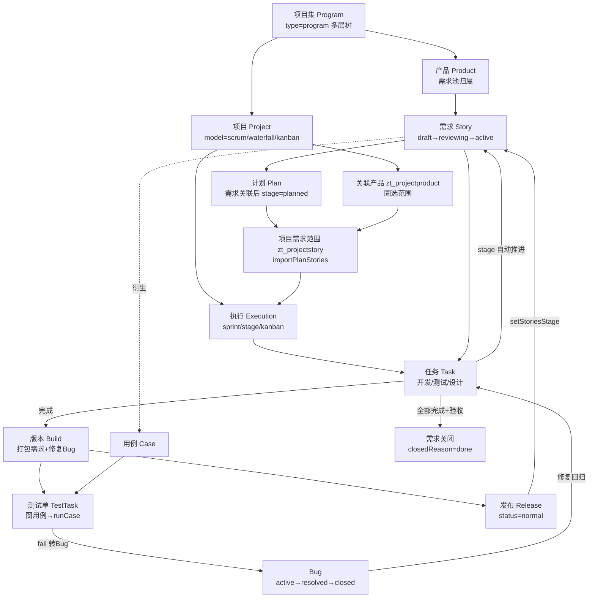
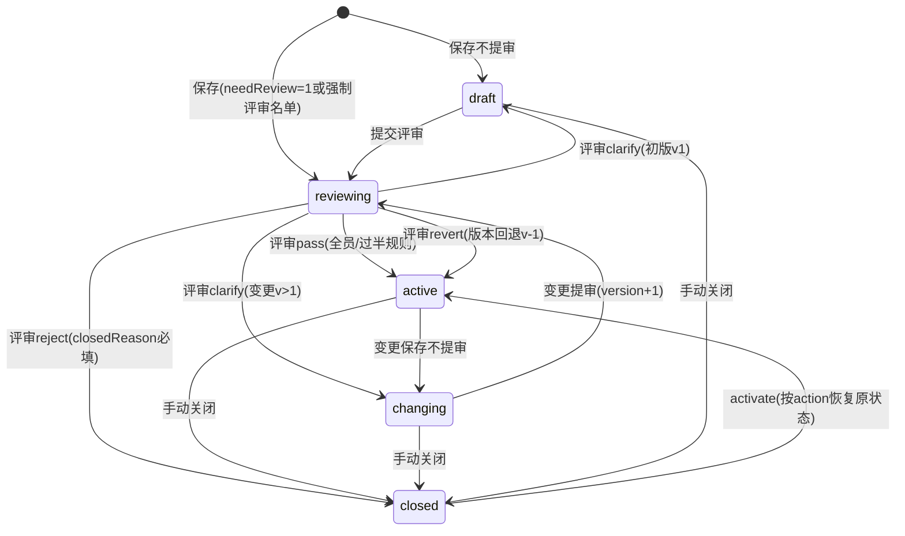
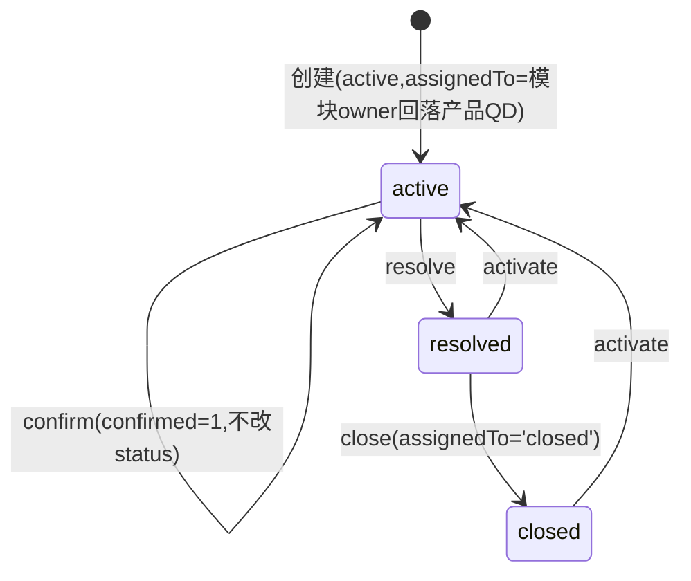

# 禅道开源版 22.7 核心产品流程细化（源码校准版）

| 项 | 内容 |
| --- | --- |
| 源码基准 | github.com/easysoft/zentaopms @ VERSION 22.7（本地克隆：monorepo 根 `reference/zentaopms/`，只读不参与构建） |
| 文档版本 | v1.1（编号与引用随文档体系 v2.0 重构更新；内容不变） |
| 文档目的 | 为复刻项目提供**代码级校准**的业务流程规格——**全文档体系流程类最高仲裁** |
| 证据约定 | `file:line` 均相对禅道仓库根目录；表结构来自 `db/zentao.sql` 与 `db/standard/zentao22.7.sql` |
| 配套文档 | [01-总体设计](./01-总体设计.md)（架构）；[03-接口与契约](./03-接口与契约.md)（端点与权限点映射本文动作）；[04-数据与种子](./04-数据与种子.md)（表结构落地）；[05-前端架构](./05-前端架构.md)（页面承载本文流转）。导航见 [README](./README.md) |

---

## 0. 源码阅读约定（复刻时的分层对照）

禅道 22.7 每个业务模块的代码分层，可直接映射到 NestJS 的分层：

| 禅道层 | 文件 | 职责 | NestJS 对应 |
| --- | --- | --- | --- |
| 入口层 | control.php | 路由入口、权限、装配表单 | Controller |
| 流程逻辑层 | zen.php | **状态流转编排、表单构建校验、副作用调度** | Service |
| 数据层 | tao.php + model.php | SQL 读写、数据聚合 | Repository + Service 数据方法 |
| 枚举文案 | lang/zh-cn.php | 全部状态/类型枚举的权威来源 | 常量枚举定义 |
| 表单定义 | config/form.php | 字段、默认值 | DTO |

> **流转校验三层结构（复刻必须对齐）**：① 入口合法性 `isClickable`（决定按钮/端点可用）→ ② zen 层表单校验 → ③ model 层落库 + 副作用钩子。`dao->checkFlow()` 仅是商业版工作流扩展点（`lib/dao/dao.class.php:282`），开源版空操作，**不要复刻**。

---

## 1. 端到端产品流程全景



**一条需求的完整生命周期**（复刻 E2E 验收脚本按此编写）：

```
创建(draft) → 提审(reviewing) → 评审通过(active) → 关联计划(stage=planned)
→ 项目导入范围(zt_projectstory) → 关联执行(stage=projected)
→ 拆开发/设计/测试任务(stage 随任务状态推进：designing/designed/developing/developed/testing/tested)
→ 开发完成 → 建版本Build → 建测试单 → 执行用例(fail转Bug→修复→回归)
→ 发布Release(stage=released) → 验收 → 关闭需求(closedReason=done, stage=closed)
```

---

## 2. 组织与权限模型（源码校准）

### 2.1 功能权限：`zt_grouppriv(group, module, method)`

- v22 **无 `zt_priv` 表**，功能权限点就是「组 × 模块 × 方法」三元组（`db/zentao.sql`，UNIQUE(group,module,method)）——与 nest-admin 的「接口权限存 DB」思路完全一致，**验证了原设计方向**。
- 登录装配：`user->authorize()`（`module/user/model.php:1156-1202`）join 三表生成 `rights[module][method]`，保底含 `index.index/my.index`。
- 请求检查链（`module/common/model.php:1219-1294 checkPriv`）：
  1. `openMethods/logonMethods` 白名单放行；
  2. `hasPriv(module, method)`（`model.php:1367-1397`，含超管直通 `model.php:1445`）；
  3. 失败 → `deny()`（`model.php:488-530`）：**重载 authorize 再试一次**，仍失败返回 403 JSON / deny 页。
- **项目级权限覆盖**：`zt_group.project` 与 `zt_usergroup.project` 支持项目内独立权限组（`common->resetProjectPriv`，`module/common/model.php:1479+`）——复刻时体现为「项目维度的角色覆盖」。
- `zt_user.role`（dev/qa/pm/po/td/pd/qd/top/others，`module/user/lang/zh-cn.php:168-177`）**仅展示用途，不参与鉴权**。

### 2.2 数据权限：三层结构（复刻核心参考）

| 层 | 存储 | 机制 |
| --- | --- | --- |
| 对象可见性 | 各业务表 `acl` 字段（`open`/`private`，产品/项目 v22 主要二值；doc/kanban 另有 `custom`） | 登录时 `grantUserView()`（`module/user/model.php:2171-2198`）计算可见对象集合 |
| 可见集合物化 | `zt_userview(account, programs, products, projects, sprints)` | ID 逗号串缓存；**列表查询统一 `WHERE id IN (user->view->xx)` 过滤**，不是 join acl |
| 白名单 | `zt_acl(account, objectType, objectID, type='whitelist')` | private 对象的授权名单；干系人/团队成员也可访问（`computeUserView`，`module/user/model.php:1975-2035`） |
| 组视野 | `zt_group.acl`（JSON：views/actions/programs/projects/products/sprints） | 优先级最高的覆盖（`mergeAclsToUserView`，`model.php:2211-2242`）；只要有一个组未配置视野即不限制（`model.php:1110`） |

> **复刻决策**：Nest 版用 Redis 缓存替代 `zt_userview` 物化表（变更时失效重算），但保留「登录/变更时预计算可见 ID 集」这一架构——避免每条列表查询都做 ACL join。

### 2.3 内置角色与团队

- 职位角色（展示用）：dev/qa/pm/po/td/pd/qd/top/others。
- 执行/项目成员：`zt_team(root, type=project|execution, account, role, hours, estimate/consumed/left)`，UNIQUE(root,type,account)。
- 产品三负责人：`zt_product.PO/QD/RD`（产品/测试/研发），参与业务回落规则（如 Bug 模块无 owner 时回落 QD）。

---

## 3. 四层管理框架（源码校准）

### 3.1 关键事实：项目集/项目/执行**三合一表**

- `config/zentaopms.php:254-256`：`TABLE_PROGRAM = TABLE_PROJECT = TABLE_EXECUTION = zt_project`。
- 层级区分靠 **`type` + `grade` + `parent` + `path`** 四字段：

| type | 含义 | grade 语义 | parent |
| --- | --- | --- | --- |
| `program` | 项目集 | 1=顶级项目集，+1 每层子项目集 | 上级项目集 ID |
| `project` | 项目 | 同上（项目挂在项目集树下） | 所属项目集 ID |
| `sprint` | Scrum 迭代 | 1=普通执行，>1=瀑布子阶段 | 所属项目（或父阶段）ID |
| `stage` | 瀑布阶段 | 同上 | 所属项目（或父阶段）ID |
| `kanban` | 看板执行 | 1 | 所属项目 ID |

- 执行类型由项目 model 映射：`module/execution/config.php:15-18` —— `scrum→sprint, waterfall→stage, kanban→kanban, waterfallplus→stage`。
- grade 计算：`grade = parent.grade + 1`，顶级为 1（`module/program/model.php:955-985`）；path 为全祖先链如 `,1,5,12,`。

**复刻决策修正**：原设计文档说「拆分为独立 zt_program/zt_project/zt_execution 三表」。源码证实禅道是单表多态。复刻版保留**拆表**（TypeORM 语义清晰、约束显式），但新增 `type`/`grade`/`path` 语义字段以对齐行为（详见 §11 对照表）。

### 3.2 项目集 Program

- 多层级树（parent/path/grade），预算 `budget+budgetUnit`，负责人 `PM`，状态 `wait/doing/suspended/closed`。
- 状态自动传播：见 §3.5 syncPPEStatus。

### 3.3 产品 Product

- 关键字段：`program`（可空=独立产品）、`line` 产品线、`shadow` 影子产品、`PO/QD/RD`、`acl + whitelist`。
- **内置统计列**（对复刻有参考价值）：`draft/active/changing/reviewing/finished/closed/total × Epics/Requirements/Stories` 各状态需求计数 + `unresolvedBugs/closedBugs/fixedBugs/totalBugs` + `plans/releases` —— 复刻版用 Redis 缓存聚合替代冗余列。
- 模块树 `zt_module(root=product, type=story|case)`，需求与用例共用。

### 3.4 项目 Project

- `model` 枚举（`module/project/lang/zh-cn.php:345-351`）：`''/scrum/waterfall/kanban/agileplus/waterfallplus/ipd`。
  - **开源版实际可用：scrum、waterfall、kanban**；agileplus/waterfallplus 为 Max 特性、ipd 为专版。
  - **源码中不存在「9 种模型」枚举**——宣传的 9 种研发管理框架是产品概念。复刻的 model 字段做成开放枚举，一期实现 `scrum/waterfall/kanban` 三个值（原设计决策维持）。
- `multiple` 字段：=0 的项目自动创建**影子迭代**（`createDefaultSprint`，`module/execution/model.php:5377-5432`，grade=1、parent=项目ID）——「单迭代项目」的实现方式；kanban 项目额外自动建 RDKanban 看板。
- 项目-产品关联：`zt_projectproduct(project, product, branch, plan, roadmap)`，UNIQUE(project,product,branch)——**项目圈选产品需求的入口**。
- 项目-需求范围：`zt_projectstory(project, product, branch, story, version, order)`，UNIQUE(project,story)；**项目与执行共用此表**（project 字段存项目 ID 或执行 ID）。

### 3.5 执行 Execution

**状态机**（`wait/doing/suspended/closed`，`module/execution/lang/zh-cn.php:214-217`）：

| 操作 | 前置 | 必填/校验 | 证据 |
| --- | --- | --- | --- |
| start | | realBegan | `config.php:37`、`model.php:826-864` |
| putoff 延期 | | | `model.php:875-906` |
| suspend 挂起 | | | `model.php:917-943` |
| activate | | **无 consumed 且无 realBegan 则回 wait**，否则回 doing | `model.php:954-1025`（958） |
| close | | realEnd；关闭前 computeBurn | `config.php:38`、`control.php:1746-1768` |

- **级联约束**（`batchChangeStatus/changeStatus2x`，`model.php:662-815`）：子阶段优先处理；回 wait 需「自身与子阶段均无 realBegan 且任务 consumed=0」；suspended 要求子阶段全部 suspended/closed，closed 要求全部 closed。
- **自动向上传播链**（复刻必做）：任务开始/记工时 → `common::syncPPEStatus`（`module/common/model.php:71-106`）→ 执行 wait→doing（realBegan=today，`model.php:208-229`）→ 子阶段开始→父阶段 doing（`syncExecutionByChild:177+`）→ 项目 wait→doing（`syncProjectStatus:145-167`）→ 项目集 doing（`syncProgramStatus:116-135`）。
- **瀑布阶段**：模板库 `zt_stage(name, percent, type, projectType)`（`module/stage`），类型枚举 `mix/request/design/dev/qa/release/review/other`（`module/stage/lang/zh-cn.php:38-52`）；创建项目阶段按 level 组父子写入 zt_project（`programplan/tao.php:557-587`）；阶段进度向上聚合 `programplan::computeProgress`。

---

## 4. 需求域 Story（最复杂，全部修正原设计）

### 4.1 类型体系：epic / requirement(UR) / story(SR) 三态同表

- 三类型共用 `zt_story`（`config/zentaopms.php:528-531` objectTables 映射）；epic/requirement 模块是 story 的纯委托壳（`module/epic/control.php:23` `fetch('story',...,'storyType=epic')`）。
- 层级：`parent/isParent/root/path/grade`；层级字典表 `zt_storygrade(type, grade, status)`。
- 名称可配置（ER/UR/SR 文案来自 `zt_lang` 表 custom/URSRList，`framework/router.class.php:399-417`）。

### 4.2 状态机（含 reviewing —— 原设计缺失）

状态枚举（`module/story/lang/zh-cn.php:266-271`）：**draft / reviewing / active / changing / closed**（另有过渡值 changingtoactive）。



**关键校准点**：

1. **初始状态由三因素决定**（`module/story/zen.php:1268` + `model.php:4316-4343`）：表单值（active/draft）→ `checkForceReview()`：全局 `needReview=1`（默认）时非免审名单用户**强制 reviewing**；`needReview=0` 时仅强制名单用户评审。**免评审则不产生 reviewing 状态，评审入口自动关闭**（`isClickable('review')` 要求 `status=='reviewing'`，`model.php:4122`）。
2. **评审结果四值**（`lang:300-304`）：`pass/revert/clarify/reject`，且**按版本裁剪**：v1 无 revert、v>1 无 reject（`zen.php:836-840`）。
3. **多评审人裁决**（`getReviewResult`，`model.php:4784-4819`）：规则 `allpass`（默认，全员 pass 才过）/`halfpass`（过半）；无规则时按 clarify>revert>reject 过半优先，否则任一即触发。
4. **评审记录表**：`zt_storyreview(story, version, reviewer, result, reviewDate)` UNIQUE(story,version,reviewer)——每版本独立评审。
5. **revert 副作用**：version-1、title 取上一版 spec、**物理删除**当前版 storyspec+storyreview（`setStatusByReviewResult`，`model.php:4843-4853`）。
6. **reject 落点**：closed + closedReason 必填；`stage = (reason=='done' && type=='story') ? 'released' : 'closed'`（`model.php:4865`）——易复刻错的细节。
7. **activate 恢复目标**：查 zt_action 最近一条关闭类动作的 extra（前置状态），closed 兜底 active（`getActivateStatus`，`model.php:5206-5255`）。

closedReason 枚举（`lang:289-296`，**修正原设计的 deferred**）：`done / subdivided / duplicate / postponed / willnotdo / cancel / bydesign`。关闭界面动态裁剪：draft 移除 cancel，一律移除 subdivided（`control.php:1110-1112`）。

### 4.3 变更流（版本化 + 受影响范围）

- 触发判定（`zen.php:1388`）：`spec/verify/title` 变化或文件变化或评审人变化 → `specChanged=true` → **version+1**、reviewedBy 清空、changedBy 记录（`zen.php:1391-1401`）。
- 副作用链（`model.php:811-879` + `tao.php:734-749`）：新 `zt_storyspec(story, version, title, spec, verify)` → 新 `zt_storyreview`（新版本待评）→ action `Changed`（+提审时 `submitReview`）→ `@提及通知` → 孪生需求（多分支 twins）同步。
- **受影响范围**（`getAffectedScope`，`model.php:218-235`）：关联执行+任务（`zt_projectstory` 反查）/ **未关闭** Bug（`bug.story in 本需求+孪生`）/ 全部关联用例 / 子需求 —— **只在变更/评审页展示提醒，不自动改写**。
- 一致性机制：任务创建时锁定 `task.storyVersion`、用例锁定 `case.storyVersion`；story 升版后两者出现「版本落后」标记，**人工确认**升级（用例侧 `batchConfirmStoryChange`，`module/testcase/model.php:1105-1130`）。
- 撤回：`recallChange`（version-1、回 active、删新版 spec/review）/`recallReview`（回 draft/changing）。

### 4.4 需求阶段 stage：自动计算引擎（原设计完全缺失的机制）

stage 枚举 15 值（`lang:273-288`）：`wait/planned/projected/designing/designed/developing/developed/testing/tested/verified/rejected/delivering/delivered/released/closed`。多分支差异存 `zt_storystage(story, branch, stage, stagedBy)`。

**setStage() 计算规则**（`model.php:2411-2448` + `tao.php:1721-1769`）：

| 条件（按优先级，后者覆盖前者） | stage |
| --- | --- |
| status=closed | closed |
| 无关联项目 | wait（无计划）/ planned（有计划） |
| 无任何任务 | projected |
| 设计任务做+开发未启 | designing → designed（设计毕） |
| 开发做+测试未启 | developing → developed（开发毕） |
| 开发毕+测试做/测试有 doing | testing |
| （开发毕或无开发）且测试毕 | tested |
| 出现在任一 `status=normal` 的发布 stories 里 | released |

**触发点清单**（复刻为事件监听）：任务创建/开始/完成/取消/关闭/激活/记工时/删工时、执行关联与解除（linkProject→projected）、计划关联与解除（linkPlan→planned）、发布创建与转 normal（→released）、人工设置（stagedBy 记人后**跳过自动计算**，`model.php:2426`）。

### 4.5 父子/孪生/关联

- 拆分 subdivide：子需求 `parent/parentVersion/root/path`，父 `isParent=1`、estimate=子求和（`computeEstimate`）；按钮约束：孪生/reviewing/closed/已有用例或任务不可拆（`model.php:4097-4114`）。
- **父子状态联动 updateParentStatus**（`model.php:1100-1162`）：子全关且仅一个子 → 父自动关（`model.php:1123` 仅单子场景）；父关而子非关 → 级联激活父；递归上溯。阶段维度另有 computeStage 逐级推进（`tao.php:1464-1592`）。
- **关闭父需求 → closeAllChildren**：所有子孙继承关闭、逐子记 `closedbyparent` action（`model.php:2599-2627`）。
- 孪生需求（多分支 twins）：变更/评审/关闭/激活全量同步（`syncTwins`，`model.php:5302-5346`）。
- Bug 转需求（独立动作，非 resolve 分支）：story create 预填 bug 内容（source=bug、spec=bug.steps，`zen.php:416-430`）→ 落库后 `closeBugWhenToStory`（`tao.php:1036-1090`）：bug 置 `toStory=storyID, status=closed, resolution=tostory, assignedTo='closed', confirmed=1`。

---

## 5. 计划 / 版本 / 发布域

### 5.1 计划 Plan

- 状态：`wait/doing/done/closed`，closedReason：`done/cancel`（`module/productplan/lang/zh-cn.php:114-120`）。
- 关联需求（`linkStory`，`module/productplan/model.php:909-945`）：写 `zt_story.plan`（text 逗号串）+ `zt_planstory(plan, story, order)`；**触发 setStage → planned**；换计划自动记 `autounlinkstory`。
- 「未来计划」isFuture：begin/end 存 `2038-01-01`（`model.php:476-477`）。
- 父子计划：parent>0 创建时 `transferStoriesAndBugs`。

### 5.2 版本 Build

- 必填：`execution, product, name, builder, date`（`module/build/config.php:5-6`）；同产品同分支 name 唯一（`model.php:528-529`）。
- **stories/bugs 是 zt_build 上的逗号分隔 text 列**（无关联表！）——创建表单直接收集（`build/zen.php:260-278`）；linkStory/linkBug 追加字符串。
- **linkBug 副作用**（`model.php:630-660`）：关联的**未解决 Bug 自动置 resolved（resolution=fixed、resolvedBuild=本build、assignedTo=openedBy）**——「修复构建」语义。

### 5.3 发布 Release

- 状态：`wait/normal/fail/terminate`（`module/release/lang/zh-cn.php:105-108`）；操作映射：wait→发布、normal→激活、terminate→停止维护。
- 创建（`model.php:399-464`）：自动建 shadow build；按所选 build **汇总 stories/bugs**（isSync）；回写需求 `releasedDate`；逐需求记 `linked2release` + setStage（linkRelease）。
- **发布动作（wait→normal）触发 `setStoriesStage(publishRelease)` → 需求 stage=released**（`model.php:917-925`）。
- `leftBugs` 遗留 Bug 列（text）；关联对象另存 `zt_releaserelated(release, objectID, objectType)`。

---

## 6. 任务与工时域

### 6.1 任务状态机（isClickable 权威表，`module/task/model.php:2533-2596`）

| 操作 | 前置状态 | 状态落点与关键副作用 |
| --- | --- | --- |
| start | **仅 wait** | doing；表单填 consumed/left；**left=0 直接置 done**（`zen.php:834-840`） |
| restart | **仅 pause** | doing（action=Restarted，`model.php:390`） |
| pause | **仅 doing** | pause；isParent 时同步暂停 doing 子任务 |
| finish | 非 done/closed/cancel | done；必填 `realStarted, finishedDate, currentConsumed`；**consumed=旧+新增**（`zen.php:977`） |
| cancel | 非 done/closed/cancel | cancel；assignedTo=openedBy；来源 bug 的 toTask 清零 |
| close | **done 或 cancel** | closed；closedReason 自动映射 done→done / cancel→cancel（`zen.php:1016-1024`） |
| activate | **done/closed/cancel**（返工） | 必填 left；story setStage(activateTask)；看板拖拽参数 drag 时 moveCard |
| assignTo | 非 closed/cancel | 转派；left 不可为 0（非父、未完成时，`model.php:537-541`） |

原设计文档的两处修正：activate 不是「重开」泛化入口而是**返工**（必填剩余工时）；restart 与 start 是两个动作。

### 6.2 多人任务（mode = linear 串行 / multi 并行）

- 成员明细在 **`zt_taskteam(task, account, estimate, consumed, left, transfer, status, order)`**（v22 无 zt_task.team 列）。
- 成员行状态推导（`manageTaskTeamMember`，`model.php:2664-2721`）：`left==0&&consumed>0→done`；任务 doing 时未完成者→doing；**linear 串行约束：同一时刻只有一个 doing**。
- 任务级状态由成员聚合自动推导（`computeTaskStatus`，`tao.php:256-303`）：consumed=0→wait；consumed>0&left>0→doing；left=0 且未全员完成→doing，**全员完成→done（assignedTo=openedBy）**。

### 6.3 父子任务

- 拆分时若原任务已有工时，先复制子任务并迁移 effort（`afterSplitTask`，`model.php:335-369`）。
- 工时聚合：父 = Σ子（排除 cancel；left 仅计非 closed 子，`computeWorkingHours`，`model.php:1033-1068`）；日期聚合 min/max（`computeBeginAndEnd`）。
- 父状态推导优先级（`tao.php:763-780`）：全 closed→closed；余全 cancel→cancel；单一状态取之；**含 doing/pause/wait→doing 优先于 done**。
- 向上传播仅落地 doing/done（`model.php:3719`）；向下传播：父 pause→暂停 doing 子、父 cancel→取消未完成子、父恢复→仅恢复被暂停子（`model.php:3746-3780`）。

### 6.4 工时：状态的真正驱动源（复刻核心机制）

- v22 **`zt_taskestimate` 已废弃**，统一 `zt_effort(objectType, objectID, product, project, execution, account, date, consumed, left, work, begin/end)`——objectType 还支持 story/bug/case/todo（工时日志通用化）。
- **聚合规则**：`task.consumed = Σeffort.consumed`（软删除外）；`task.left = 最后一条 effort 的 left`；**consumed 只增不减**（编辑校验，`model.php:3298-3302`）；删除 effort 是软删 + 全量重算。
- **记工时隐式状态迁移**（`buildTaskForEffort`，`tao.php:47-102`）：
  - left=0 且未完成 → **done**（Finished）
  - wait → **doing**（Started，assignedTo=当前人）
  - done/pause/cancel/closed 且 left≠0 → **doing**（Activated）
- 记工时副作用：父任务聚合、story setStage、看板 lane 更新、done 记积分、执行统计刷新。

### 6.5 燃尽图：每日快照表

- `zt_burn(execution, product, task, date, estimate, left, consumed, storyPoint)` UNIQUE(execution,date,task)；**每日定时任务** `execution::computeburn`（`zt_cron` 注册，`db/update22.6.sql:359`）。
- 计算（`execution/model.php:3590-3628` + `tao.php:282-323`）：范围=type∈(sprint,stage) 且非挂起/关闭；口径=Σ未取消非父任务，closedLeft 从 left 折减、finished 从 estimate 折减；storyPoint=Σ需求（stage∈wait/planned/projected/developing）；`dao->replace` 写 task=0 汇总行。
- 读取直接查 zt_burn 截断补空（`getBurnData:3810-3848`，默认周期 30 天）。
- **看板型执行用 CFD 累积流图替代燃尽**（`computeCFD`，`model.php:3638-3682`，写 zt_cfd）。

> 复刻决策：燃尽采用「定时快照 + 即时聚合兜底」双通道，与禅道一致；看板执行出 CFD。

---

## 7. 质量域

### 7.1 Bug 状态机



resolution 枚举（`module/bug/lang/zh-cn.php:281-288`，修正原设计 wontfix）：`fixed / bydesign / duplicate / external / notrepro / postponed / willnotfix` + `tostory`（**枚举保留但已移出 resolve 界面**，转需求是独立动作，见 §4.5）。

| 操作 | 前置 | 校验与副作用 |
| --- | --- | --- |
| confirm | active 且 confirmed=0 | 仅置 confirmed=1（可调 pri/deadline/assignedTo），不改 status（`control.php:469`） |
| resolve | active | fixed→**resolvedBuild 必填**；duplicate→duplicateBug 必填；**fixed+勾选createBuild→自动建 zt_build 并回填**（`model.php:553-602`）；未选 assignedTo 默认**回给 openedBy**（`zen.php:708-709`） |
| activate | resolved/closed | **activatedCount+1**；assignedTo 默认=**resolvedBy**；resolution/resolvedBy/resolvedBuild/closedBy/duplicateBug 清空（`config/form.php:129-132`） |
| close | resolved（UI 仅 resolved 展示） | assignedTo 强制 `'closed'`（特殊值，`model.php:683`） |

- 默认指派规则 `getModuleOwner`（`model.php:276-309`）：模块树自下而上找 owner，否则回落产品 QD。
- postponed 语义：resolved+resolution=postponed（「活跃+延期」查询口径 `model.php:254`）。
- 关联字段全景：story+storyVersion / task / case+caseVersion / result(测试结果) / testtask / openedBuild(多值) / resolvedBuild / injection+identify(注入分析) / duplicateBug / relatedBug。

### 7.2 用例 Case

- 状态：`wait(待评审)/normal(正常)/blocked/investigate`（后两者开源版流程**无写入入口**，保留枚举）。
- **默认免评审**（`$config->testcase->needReview = 0`，`module/testcase/config.php:5`——与 story 相反！）：创建直接 normal；开评审时 wait。
- 评审结果仅两值（`lang:249-251`）：`pass→normal`、`clarify→留在 wait`；批量评审仅对 wait 生效（`model.php:735-767`）。
- **步骤版本化**：title/precondition/steps 任一变化 → version+1，新版本 steps 整套重插（type=step/group/item，parent 支持步骤组），同步更新 `zt_testrun.caseVersion`（`tao.php:492-523`）；历史摘要存 `zt_casespec`。
- **storyChanged 确认机制**：`story.version != case.storyVersion` 即标记「需求已升级」，人工确认更新 storyVersion（`control.php:1130-1143`）。

### 7.3 测试单 TestTask

- 状态：`wait/doing/done(=已关闭)/blocked`（`module/testtask/lang/zh-cn.php:138-141`，**done 与 closed 合并**）。

| 操作 | 前置 | 校验 |
| --- | --- | --- |
| start | 仅 wait | realBegan 必填 → doing |
| block | wait/doing | → blocked |
| activate | blocked/done | → doing |
| close | 非 done | realFinishedDate 必填且晚于 begin → done |

- **圈用例 linkCase**：`replace INTO zt_testrun(task, case, caseVersion, status='normal', assignedTo)`（UNIQUE(task,case)），同步写 `zt_projectcase`（`model.php:930-992`）。
- **执行用例 runCase**（`createResult`，`model.php:1452-1511`）三写：① `zt_case.lastRunResult/lastRunner/lastRunDate`（用例级结果=步骤聚合：任一步 fail→fail）；② 每次执行插一条 `zt_testresult(run, case, version, caseResult, stepResults)`；③ 更新 `zt_testrun`（blocked 时 status=blocked）。**wait→doing 由首次执行自动触发**（`updateStatus:898-918`）；**没有「全部跑完自动 done」**，close 必须人工。
- **fail 转 Bug**：`bug->getBugInfoFromResult(resultID,...)`（`module/bug/model.php:1420-1472`）反序列化 stepResults 拼装重现步骤模板，bug 表单携带 `case/caseVersion/result/testtask` 实现全程溯源。

---

## 8. 看板（源码校准，两套体系）

### 8.1 执行任务看板（复刻目标）

三表结构（kanban=executionID）：

| 表 | 职责 | 关键字段 |
| --- | --- | --- |
| `zt_kanbanlane` | 泳道 | execution, **type(story/bug/task/…)**, name, color, order——默认泳道配置 `kanban/config.php:60-86` |
| `zt_kanbancolumn` | 列 | execution, **parent（develop 父列→developing/developed 子列）**, **limit（WIP，-1=不限）**, name, order |
| `zt_kanbancell` | 单元格 | kanban, lane, column, **cards（对象 ID 逗号串）**，UNIQUE(kanban,type,lane,column) |

- **任务状态↔列映射**（`kanban/config.php:128-134`）：`wait→wait, doing→developing, done→developed, pause→pause, cancel→canceled, closed→closed`。
- **自动归位**：任务任何状态变化 → `task::updateKanbanCell`（`model.php:3548-3552`）→ `kanban::updateLane`→`refreshCards`（`kanban/model.php:2851-2943`）按映射搬移 ID。
- **拖拽 = 映射为任务动作**（`execution/js/kanban.ui.js:441-503`）：拖到不同列即触发对应 task 动作（developed 列→finish、拖回 developing→activate）并附 `extra=fromColID,toColID,fromLaneID,toLaneID` → 服务端 `kanban::moveCard`（`kanban/model.php:3239-3292`）搬移 cell.cards。
- **WIP**：`zt_kanbancolumn.limit`；**超限仅前端角标提示，不硬拦**（`kanban/js/view.ui.js:66`）；子列 limit 合计 ≤ 父列（`kanban/model.php:470-500`）。
- 列初始化：任务列默认 `wait/develop/developing/developed/pause/canceled/closed`（`kanban/lang/zh-cn.php:310-317`）。

### 8.2 独立看板空间（与执行看板是两套数据）

`zt_kanbanspace + zt_kanban + zt_kanbancard（独立卡片对象，fromID/fromType 溯源 story/task/bug）+ region/group 层级`。复刻一期可只做执行看板，空间看板列为 P6 可选项。

> **复刻决策修正**：原设计用 `board_column/board_card/board_card_comment` 表 + flusys 模块。源码校准后建议：**列结构对齐 kanbancolumn（含 parent 父子列、limit=WIP），卡片即任务/Story/Bug 本体（cells 存 ID 串）而非独立卡片表**；Socket.IO 事件里服务端写库仍以 task/story 状态动作为唯一事实源，与禅道「拖拽=动作」语义完全一致。卡片评论用 bug/task 的 action(comment) 机制承载。

---

## 9. 横切机制

### 9.1 操作日志与变更明细

- `zt_action(objectType, objectID, actor, action, date, comment, extra, read, efforted)` + 热表 `zt_actionrecent` + 拆表 `zt_actionproduct`。
- **变更明细独立表 `zt_history(action, field, old, old/newValue)`**——统一 `common::createChanges(old, new)` 生成。复刻时 action+history 适合合为一主一从两表。
- 状态恢复依赖 action.extra：story activate 从 extra 读回原状态（§4.2）。

### 9.2 通知体系

- 触发链：所有动作先写 action → `action->create()` 末尾钩子 `message->send()`（`module/action/model.php:130`）→ 三通道分发（`module/message/model.php:88-159`）：**mail / webhook（钉钉/企微/飞书）/ 站内信 `zt_notify`**。
- **@提及独立通道** `sendMentionNotice`：从 steps/comment HTML 解析 @人（`model.php:602-664`）。
- 收件人规则：toList 优先 `assignedTo`（testtask→owner、todo→account），回落各对象 mailto（`model.php:458-493`）。
- **可通知动作矩阵**（`module/message/config.php:2-18`，复刻直接采用）：task: opened/edited/commented/assigned/confirmed/started/finished/paused/canceled/restarted/closed/activated/mentioned；bug: opened/edited/commented/assigned/confirmed/bugconfirmed/resolved/closed/activated/mentioned；story: opened/edited/commented/frombug/changed/submitreview/reviewed/closed/activated/assigned/mentioned；testtask: opened/edited/started/blocked/closed/activated 等。

### 9.3 其它联动

- todo 联动：todo 转需求/任务后 todo 自动 done（`story/model.php:619-629`、`task/model.php:303-306`）。
- 积分：task finish/close、bug open/confirm 等（`score->create`）——复刻可选。
- 每日定时任务注册表 `zt_cron`（燃尽、CFD 等）。

---

## 10. 对复刻系统的设计修正清单（落地行动项）

| # | 原设计文档内容 | 源码校准结论 | 处置 |
| --- | --- | --- | --- |
| 1 | story 状态 draft/active/changing/closed | 必须含 **reviewing**（评审中）+ 免评审开关 needReview + 强制评审名单 | ✅ 已修正 |
| 2 | story closedReason: done/deferred/cancel/subdivided | `done/subdivided/duplicate/postponed/willnotdo/cancel/bydesign`（无 deferred） | ✅ 已修正 |
| 3 | story 未设计 stage 机制 | **15 值 stage + 自动计算引擎**（任务/计划/发布/人工四类触发）——需求域核心机制 | 新增 §4.4，复刻必须实现 |
| 4 | 评审 = 单人结果 | 多评审人 + zt_storyreview 版本化记录 + allpass/halfpass 裁决 + revert 物理回退 | 细化实现 |
| 5 | bug resolution: wontfix | **willnotfix**；tostory 移出 resolve（独立动作）；fixed 可自动建 Build；activate 回给 resolvedBy 且 activatedCount+1 | ✅ 已修正 |
| 6 | bug 确认机制缺失 | confirm 仅置 confirmed=1 不改状态 | 新增 |
| 7 | task activate 语义模糊 | activate=返工（done/closed/cancel→doing，必填 left）；restart 独立于 start | ✅ 已修正 |
| 8 | task_estimate 表 | v22 已废弃，统一 **zt_effort**（objectType 通用化）；记工时**隐式驱动状态**（完成/开始/激活） | 表合并 + 隐式迁移实现 |
| 9 | 测试单 done=已完成 | done 即「已关闭」，无自动完成；wait→doing 由执行用例触发 | ✅ 已修正 |
| 10 | 用例默认走评审 | 用例**默认免评审**（needReview=0），评审结果仅 pass/clarify | ✅ 已修正 |
| 11 | 燃尽「每日快照+实时兜底」 | 确认一致（zt_burn replace task=0；看板执行出 CFD） | 维持 |
| 12 | 看板独立卡片表 board_card | 禅道卡片=**业务对象本体**（cell.cards 存 ID 串），列有父子结构，WIP=limit 仅提示 | 结构对齐禅道 |
| 13 | 三表拆分 program/project/execution | 禅道为单表多态（type/grade/parent/path）；复刻保留拆表但补齐语义字段 | 折中方案 §11 |
| 14 | 数据权限 sys_acl | 禅道三层：acl 字段 + **userview 预计算 ID 集** + zt_acl 白名单 + 组视野 JSON | 复刻用 Redis 替代 userview |
| 15 | 9 种管理模型 | 源码枚举仅 `''/scrum/waterfall/kanban/agileplus/waterfallplus/ipd`，开源可用 3 种 | model 开放枚举维持，待确认清单 |
| 16 | 执行状态无自动传播 | **syncPPEStatus 链**：任务开始→执行→项目→项目集逐级 wait→doing | 新增必做 |
| 17 | 通知模块 | 三通道+@提及+动作矩阵+收件人规则（优先 assignedTo） | 按 §9.2 实现 |

---

## 11. 表结构对照（禅道 → Nest 复刻映射）

| 禅道表 | 复刻表 | 差异说明 |
| --- | --- | --- |
| zt_user | sys_user | md5→bcrypt；role 保留为展示字段 |
| zt_group + zt_usergroup + zt_grouppriv | sys_role + sys_user_role + sys_permission + sys_role_permission | 禅道权限点隐式于 module/method，复刻显式建权限点表（对齐 nest-admin） |
| zt_userview + zt_acl + zt_group.acl | Redis 可见性缓存 + sys_acl | 预计算逻辑保留，物化表→缓存 |
| zt_project(type=program/project/sprint/stage/kanban) | zt_program + zt_project + zt_execution | 拆表但均含 type/grade/path/parent/acl/whitelist/PO-PM-QD-RD |
| zt_team(root,type) | project_member + execution_member（或统一 team 表） | 保留 UNIQUE(root,type,account) 语义 |
| zt_product | zt_product | 统计列改 Redis 聚合 |
| zt_story + zt_storyspec + zt_storyreview + zt_storystage + zt_storygrade | zt_story + zt_story_spec + zt_story_review + zt_story_stage + zt_story_grade | 五表全保留 |
| zt_productplan + zt_planstory | zt_plan + zt_plan_story | |
| zt_projectproduct + zt_projectstory + zt_projectcase | zt_project_product + zt_project_story + zt_project_case | projectstory 需兼容项目/执行双 ID 语义 |
| zt_task + zt_taskteam + zt_effort | zt_task + zt_task_team + zt_effort | effort 通用 objectType |
| zt_bug | zt_bug | 全关联字段保留（§7.1） |
| zt_case + zt_casestep + zt_casespec | zt_case + zt_case_step + zt_case_spec | 步骤 parent/type 组结构保留 |
| zt_testtask + zt_testtaskproduct + zt_testrun + zt_testresult | zt_testtask + zt_testtask_product + zt_test_run + zt_test_result | 四表全保留（result 明细是转 Bug 溯源基础） |
| zt_build（stories/bugs 逗号串） | zt_build + zt_build_story + zt_build_bug | **复刻规范化为关联表**（查询/统计需要，语义不变） |
| zt_release（stories/bugs/leftBugs 逗号串）+ zt_releaserelated | zt_release + zt_release_related | 同上；leftBugs 可保留 text 或规范化 |
| zt_kanbanlane + zt_kanbancolumn + zt_kanbancell | board_lane + board_column(含 parent/limit) + board_cell(cards) | 对齐禅道三表结构 |
| zt_burn + zt_cfd | zt_burn + zt_cfd | 同名同构 |
| zt_action + zt_history + zt_actionrecent | zt_action_log + zt_action_history | 热表由 Redis/索引替代 |
| zt_todo + zt_notify | zt_todo + zt_notify | |
| zt_cron | 定时任务（@nestjs/schedule） | |
| zt_module + zt_file + zt_relation | zt_module + zt_file + zt_relation | relation 通用关联表保留 |

---

## 12. 尚需人工确认的事项

1. **9 种管理模型最终清单**：源码确认开源版仅 3 种可用；若产品仍要求 9 种，需给出清单（候选：LeSS/SAFe/看板方法/水晶/XP/Kanban+Scrum混合等均无源码支撑，属于自研扩展）。
2. **zt_relation 通用关联表**是否照搬（禅道用它承载「相关需求/重复Bug关联」等 N 种关系）——建议保留，通用性强。
3. 积分（score）与每周报告（weekly）是否纳入复刻范围（禅道有完整实现，原设计未提及）。
4. IPD/agileplus/waterfallplus 特性明确排除在开源复刻范围外。
